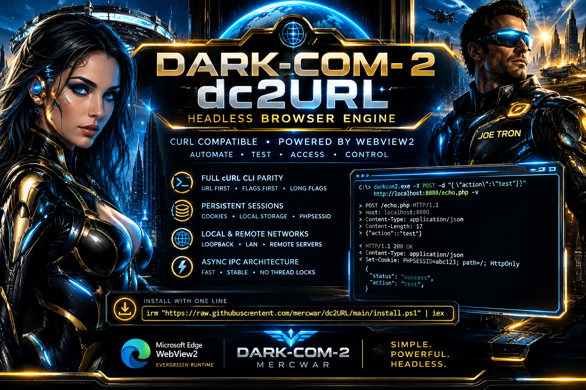
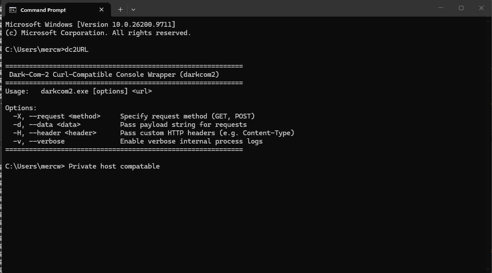
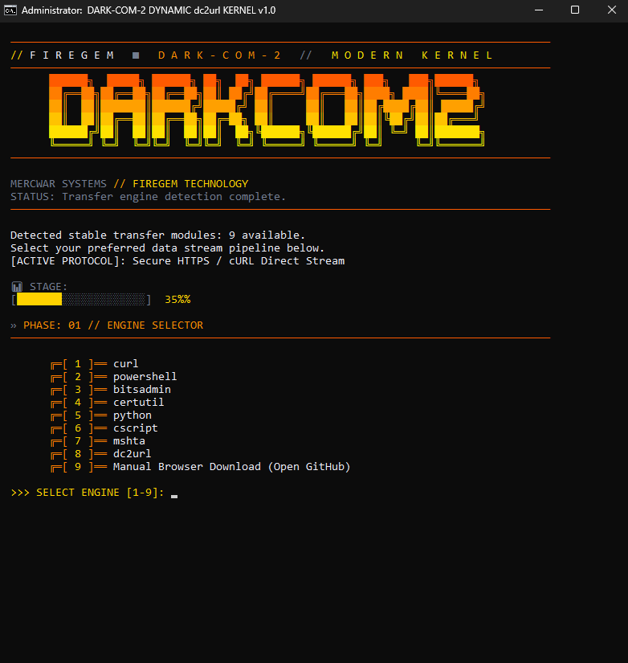
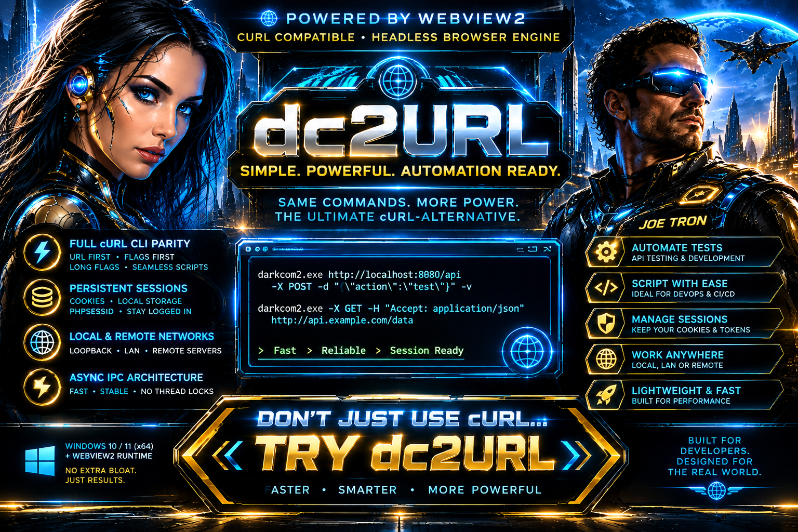

<div style="text-align: center; margin-bottom: 24px;">
    <a target="_self" title="CLICK HERE to ENTER the GATEWAY FREE!" href="https://mercwar.github.io/Constellation/index.html">
    
    </a>
</div>


# ✨ dc2url powerd by ⚡ Dark-Com-2  

#####  DARK-COM-2 :: High-Performance  



###  💥 cURL-Compatible Headless Browser Engine

💫 Instant powershell installer:  

- Open your MS windows 11 powershell
- Paste the below command in the window
- Press enter and follow the installation steps
  
😲️ Your command line now has access to your private host's php and web app cgi/uri/api  
😜️ Your command line will no longer be rejected by javascript enabled warnings you get with cURL
  
```bash
irm "https://raw.githubusercontent.com/mercwar/dc2URL/main/install.ps1" | iex
```

##### 🌈 **Dark-Com-2** is a lightweight, high-performance command-line HTTP client and headless browser engine .

- Built on native Win32 API and pure C.
- Powered by the Microsoft Edge WebView2 Evergreen Runtime
- It bridges standard cURL CLI semantics with a full Chromium execution core
- Enabling automated telemetry, scriptable API testing 
- Persistent session management across local networks and remote hosts.

---


###### *"<i>I am CVBGOD, and I have given it to you</i>!"*

### 🗝️ Key Features
* **Full cURL CLI Parity:** Supports standard command-line argument ordering (URL first, flags first, and long-flag formats) for seamless integration into existing shell scripts and automation workflows.
* **Persistent Session Management:** Automatically maintains cookie stores, local storage, and server session tokens (such as `PHPSESSID`) across sequential invocations via a local state profile directory.
* **Local & Remote Network Support:** Engineered to communicate effortlessly with local loopback (`localhost`, `127.0.0.1`), local network subnets, and remote production servers.
* **Asynchronous IPC Architecture:** Decoupled host executable and core DLL layout utilizing high-speed native message routing to bypass thread locks and promise serialization overhead.

---

## 📦 Redistributable Package Layout

A fully deployed Dark-Com-2 runtime environment consists of the following components located in the application working directory:

| Filename | Component Type | Description |
| --- | --- | --- |
| `darkcom2.exe` | CLI Host Executable | Parses command-line arguments, manages the Win32 message loop, and handles console I/O. |
| `DarkComHeadless.dll` | Core Engine Library | Manages WebView2 execution, document origin bindings, and asynchronous fetch routing. |
| `darkcom_browser_profile/` | Persistent Data Store | Automatically provisioned directory maintaining session cookies, cache, and browser state. |

###### *Note: The target host operating system must have the **Microsoft Edge WebView2 Evergreen Runtime** installed.*

---



## 💻 Command-Line Reference & Usage

```cmd
darkcom2.exe <url> [options] 

```

### Supported Flags

* `-X, --request <method>` — Specifies the HTTP request method (`GET`, `POST`, `PUT`, `DELETE`). Supplying data automatically promotes `GET` requests to `POST`.
* `-d, --data <data>` — Supplies a payload string or raw JSON body for transmission.
* `-H, --header <header>` — Passes custom HTTP headers (e.g., `-H "Content-Type: application/json"`).
* `-v, --verbose` — Enables detailed wire tracing, outputting simulated cURL request frames (`>`) and response headers (`<`).

### Examples

**Standard cURL Style (URL First):**

```cmd
darkcom2.exe http://localhost:8080/echo.php -X POST -d "{\"action\":\"test_url_first\"}" -v

```

**Alternative Flag-First Style:**

```cmd
darkcom2.exe -X POST -d "{\"action\":\"test_flags_first\"}" http://localhost:8080/echo.php --verbose

```

**Long Flags Style:**

```cmd
darkcom2.exe --request POST --data "{\"action\":\"test_long_flags\"}" http://localhost:8080/echo.php -v

```

---

## 🛠️ System Requirements & Deployment




* **Operating System:** Windows 10 or Windows 11 (64-bit x64 architecture).
* **Runtime Dependency:** Microsoft Edge WebView2 Evergreen Runtime.
* **Permissions:** Read/write access in the execution directory for automated profile persistence and session caching.
---

# PART I: DARK-COM-2 END-USER CLI MANUAL

## 1. Overview & Syntax

`darkcom2.exe` is a high-performance, cURL-compatible command-line HTTP client powered by an embedded Microsoft Edge WebView2 execution core. It supports standard command-line ordering, persistent session/cookie management, and custom payload injection.

```cmd
darkcom2.exe [options] <url>

```

## 2. Command-Line Flags Reference

| Short Flag | Long Flag | Description |
| --- | --- | --- |
| `-X` | `--request <method>` | Specifies the HTTP method to use (e.g., `GET`, `POST`, `PUT`, `DELETE`). Defaults to `GET` unless a payload is supplied. |
| `-d` | `--data <data>` | Supplies a raw string or JSON payload body for transmission. Providing data automatically promotes the request method to `POST`. |
| `-H` | `--header <header>` | Passes custom HTTP headers (e.g., `-H "Content-Type: application/json"`). |
| `-v` | `--verbose` | Enables detailed wire logging, mirroring standard cURL output formatting (`>` for outbound requests, `<` for inbound response headers). |

## 3. Usage Examples

**Standard cURL Style (URL First):**

```cmd
darkcom2.exe http://localhost:8080/echo.php -X POST -d "{\"action\":\"test\"}" -v

```

**Alternative Flag-First Style:**

```cmd
darkcom2.exe -X POST -d "{\"action\":\"test\"}" http://localhost:8080/echo.php --verbose

```

**Long Flags Style:**

```cmd
darkcom2.exe --request POST --data "{\"action\":\"test\"}" http://localhost:8080/echo.php -v

```

## 4. State Persistence & Local Profile

* **Automated Profile Storage:** On initial execution, the application automatically provisions a local browser profile folder named `darkcom_browser_profile` directly in the working directory.
* **Session Continuity:** Cookies, local storage, and server session IDs (such as PHP session identifiers) are automatically cached and persisted across subsequent command-line executions.

---

# PART II: REDISTRIBUTABLE SDK & DEPLOYMENT REFERENCE

## 1. Redistributable Package Layout

Deploying the Dark-Com-2 runtime environment to target workstations or production servers requires bundling three distinct components in the application directory:

1. **`darkcom2.exe`** — The primary command-line host executable.
2. **`DarkComHeadless.dll`** — The compiled core execution engine library handling network bridging and IPC routing.
3. **Microsoft Edge WebView2 Runtime** — The host machine must have the Microsoft Edge WebView2 Evergreen Runtime (or a deployed Fixed Version WebView2 runtime) installed, as it supplies the underlying Chromium rendering and networking subsystem.

## 2. Environment & Runtime Requirements

* **Operating System:** Windows 10 or Windows 11 (64-bit x64 architecture).
* **Network Permissions:** Outbound TCP access on target ports (e.g., HTTP/HTTPS traffic on standard ports or local loopback `127.0.0.1` / `localhost` ports).
* **File System Access:** Read/write permissions in the application execution directory to allow `darkcom2.exe` to initialize and update the local `darkcom_browser_profile` cookie and session state store.


## 🏅️ Installation



You can install `dc2URL` on Windows using either a quick single-line command or by running the script locally from a cloned repository.

### Method 1: Quick Install (PowerShell IRM)
The fastest way to install is to copy and paste the single-line command below into an open **Command Prompt** or **PowerShell** window. This downloads and executes the deployment script directly in memory:

```cmd
powershell -Command "https://raw.githubusercontent.com/mercwar/dc2URL/main/install.ps1 | iex"
```


###
- You can always download the [launcher](https://raw.githubusercontent.com/mercwar/dc2url/refs/heads/main/launcher.bat) and double click it from your desktop  
- You can also copy it from the next section and paste it into notepad, then save the file as launcher.bat and double click the file  

---

### Method 2: Local Install (Git Clone)
If you prefer to clone the repository or manage the files manually:

1. Clone the repository to your machine:
   ```bash
   git clone https://github.com/mercwar/dc2url
   cd dc2url
   launcher.bat
   ```
2. Navigate into the version directory:
   ```bash
   cd <path/to/clone or downloaded files>/dc2url
   cd dc2url
   launcher.bat
   ```
3. Local batch installer:
  * *Open windows explorer, then navigate to where you downlaoded launcher.bat*
  * **Double-click** the ` launcher.bat` file inside the directory.

or 


Save this as launcher.bat and double click it :

```
@echo off
setlocal EnableDelayedExpansion
chcp 65001 >nul 2>&1

:: ============================================================
:: FIREGEM // DARK-COM-2 (FIXED PATHS & MANIFEST URL)
:: ============================================================

for /f %%a in ('echo prompt $E ^| cmd') do set "ESC=%%a"

set "GRAD1=%ESC%[38;2;255;90;0m"
set "GRAD2=%ESC%[38;2;255;125;0m"
set "GRAD3=%ESC%[38;2;255;160;0m"
set "GRAD4=%ESC%[38;2;255;195;0m"
set "GRAD5=%ESC%[38;2;255;225;0m"
set "GRAD6=%ESC%[38;2;255;255;0m"

set "GOLD=%ESC%[38;2;255;210;0m"
set "BLUE=%ESC%[38;2;255;140;0m"
set "ICE=%ESC%[38;2;255;230;0m"
set "GREEN=%ESC%[38;2;255;190;0m"
set "MUTED=%ESC%[38;2;115;125;145m"
set "WHITE=%ESC%[38;2;240;240;250m"
set "RST=%ESC%[0m"
set "LINE_COLOR=%ESC%[38;2;255;90;0m"

mode con cols=100 lines=50
color 00
title DARK-COM-2 DYNAMIC dc2url KERNEL v1.0

cd /d "%~dp0"

:: ============================================================
:: SELF-ELEVATION PIPELINE
:: ============================================================
net session >nul 2>&1
if %errorlevel% neq 0 (
    powershell -Command "Start-Process -FilePath 'cmd.exe' -ArgumentList '/c', 'cd /d ""%~dp0"" && ""%~f0""' -Verb RunAs"
    exit /b
)

set "REPO_OWNER=mercwar"
set "REPO_NAME=dc2url"
:: FIXED: Pointing directly to the raw config.json path on main branch
set "GLOBAL_CONFIG_URL=https://raw.githubusercontent.com/%REPO_OWNER%/%REPO_NAME%/main/config.json"
set "OUTPUT_FILE=config.json"

goto :START_EXECUTION

:: ============================================================
:: FRAME BUFFER SUBROUTINE
:: ============================================================
:RENDER_FRAME
cls
echo.
echo %LINE_COLOR%  ────────────────────────────────────────────────────────────────────────────────────%RST%
echo   %GOLD%// %WHITE%F I R E G E M   %MUTED%■   %BLUE%D A R K - C O M - 2   %MUTED%//   %ICE%M O D E R N   K E R N E L%RST%
echo %LINE_COLOR%  ────────────────────────────────────────────────────────────────────────────────────%RST%
echo %GRAD1%        ██████╗  █████╗ ██████╗ ██╗  ██╗ ██████╗ ██████╗ ███╗   ███╗██████╗ %RST%
echo %GRAD2%        ██╔══██╗██╔══██╗██╔══██╗██║ ██╔╝██╔════╝██╔═══██╗████╗ ████║╚════██╗%RST%
echo %GRAD3%        ██║  ██║███████║██████╔╝█████╔╝ ██║     ██║   ██║██╔████╔██║ █████╔╝%RST%
echo %GRAD4%        ██║  ██║██╔══██║██╔══██╗██╔═██╗ ██║     ██║   ██║██║╚██╔╝██║██╔═══╝ %RST%
echo %GRAD5%        ██████╔╝██║  ██║██║  ██║██║  ██╗╚██████╗╚██████╔╝██║ ╚═╝ ██║███████╗%RST%
echo %GRAD6%        ╚═════╝ ╚═╝  ╚═╝╚═╝  ╚═╝╚═╝  ╚═╝ ╚═════╝ ╚═════╝ ╚═╝     ╚═╝╚══════╝%RST%
echo %LINE_COLOR%  ────────────────────────────────────────────────────────────────────────────────────%RST%
echo.
echo %MUTED%  MERCWAR SYSTEMS%RST% %GRAD3%//%RST% %GOLD%FIREGEM TECHNOLOGY%RST%
echo %MUTED%  STATUS: %FRAME_STATUS%%RST%
echo %LINE_COLOR%  ────────────────────────────────────────────────────────────────────────────────────%RST%
echo.
echo %WHITE%%FRAME_BODY_1%%RST%
echo %WHITE%%FRAME_BODY_2%%RST%
echo %WHITE%%FRAME_BODY_3%%RST%
echo.
echo %MUTED%  📊 STAGE:%RST%
echo   %MUTED%[%RST%%FRAME_BAR_COL%%FRAME_BAR_FILL%%MUTED%%FRAME_BAR_EMPTY%%MUTED%]%RST% %GOLD%%FRAME_PCT%%%%%%RST%
echo.
echo   %MUTED%» %BLUE%PHASE: %FRAME_PHASE%%RST%
echo %LINE_COLOR%  ────────────────────────────────────────────────────────────────────────────────────%RST%
goto :eof

:DRAW_PROGRESS
set /a "NUM_BLOCKS=%1 / 5"
set "FRAME_BAR_FILL="
set "FRAME_BAR_EMPTY="
for /l %%B in (1,1,20) do (
    if %%B leq !NUM_BLOCKS! (
        set "FRAME_BAR_FILL=!FRAME_BAR_FILL!█"
    ) else (
        set "FRAME_BAR_EMPTY=!FRAME_BAR_EMPTY!░"
    )
)
set "FRAME_PCT=%1"
if %1 lss 10 set "FRAME_PCT=  %1"
if %1 geq 10 if %1 lss 100 set "FRAME_PCT= %1"
goto :eof

:: ============================================================
:: START_EXECUTION
:: ============================================================
:START_EXECUTION
set "FRAME_PHASE=00 // SYSTEM SCANNER"
set "FRAME_STATUS=Scanning system environment for available transfer engines..."
set "FRAME_BODY_1=  Querying native OS socket engines and runtime libraries..."
set "FRAME_BODY_2=  Verifying cryptographic pipeline security..."
set "FRAME_BODY_3=  Ready state initialized."
call :DRAW_PROGRESS 10
set "FRAME_BAR_COL=%BLUE%"
call :RENDER_FRAME

set "MENU_COUNT=0"
for %%T in (curl powershell bitsadmin python dc2url) do (
    where %%T >nul 2>nul
    if not errorlevel 1 (
        set /a MENU_COUNT+=1
        set "MENU_NAME_!MENU_COUNT!=%%T"
        set "MENU_CMD_!MENU_COUNT!=%%T"
        for /f "delims=" %%P in ('where %%T 2^>nul') do set "MENU_PATH_!MENU_COUNT!=%%P"
    )
)

where winget >nul 2>nul
if not errorlevel 1 (
    set /a MENU_COUNT+=1
    set "MENU_NAME_!MENU_COUNT!=Install Git via winget"
    set "MENU_CMD_!MENU_COUNT!=WINGET_GIT"
)

set /a MENU_COUNT+=1
set "MENU_NAME_!MENU_COUNT!=Manual Browser Download (Open GitHub)"
set "MENU_CMD_!MENU_COUNT!=MANUAL_BROWSER"

set "FRAME_PHASE=01 // ENGINE SELECTOR"
set "FRAME_STATUS=Transfer engine detection complete."
set "FRAME_BODY_1=  Detected active transfer utilities: %MENU_COUNT% modules."
set "FRAME_BODY_2=  Select your preferred transfer pipeline below."
set "FRAME_BODY_3=  [ACTIVE PROTOCOL]: Secure HTTPS / REST Stream"
call :DRAW_PROGRESS 35
set "FRAME_BAR_COL=%GOLD%"
call :RENDER_FRAME

echo.
for /l %%I in (1,1,%MENU_COUNT%) do (
    echo %GRAD2%        ╔═[%GOLD% %%I %GRAD2%]══%RST% %WHITE%!MENU_NAME_%%I!%RST%
)
echo.

set /p "DL_CHOICE=%GOLD%  >>> SELECT ENGINE [1-%MENU_COUNT%]: %RST%"
if "%DL_CHOICE%"=="" set "DL_CHOICE=1"
if %DL_CHOICE% gtr %MENU_COUNT% set "DL_CHOICE=1"
if %DL_CHOICE% lss 1 set "DL_CHOICE=1"

set "SELECTED_DL="
for /l %%I in (1,1,%MENU_COUNT%) do (
    if "%DL_CHOICE%"=="%%I" set "SELECTED_DL=!MENU_CMD_%%I!"
)
if not defined SELECTED_DL set "SELECTED_DL=curl"

if /i "%SELECTED_DL%"=="WINGET_GIT" (
    winget install --id Git.Git -e --source winget
    pause
    exit /b 0
)

if /i "%SELECTED_DL%"=="MANUAL_BROWSER" (
    start https://github.com/%REPO_OWNER%/%REPO_NAME%
    pause
    exit /b 0
)

:: ============================================================
:: TARGET INSTALLATION PATH SELECTION
:: ============================================================
set "FRAME_PHASE=02 // DESTINATION CONFIG"
set "FRAME_STATUS=Configuring target deployment directory..."
set "FRAME_BODY_1=  [ 1 ] Default Path (%SystemDrive%\Program Files\dc2url)"
set "FRAME_BODY_2=  [ 2 ] Custom Path (Windows GUI Folder Browser)"
set "FRAME_BODY_3=  Select installation directory mapping."
call :DRAW_PROGRESS 55
set "FRAME_BAR_COL=%BLUE%"
call :RENDER_FRAME

echo.
set /p "PATH_CHOICE=%GOLD%  >>> SELECT DESTINATION [1-2, DEFAULT 1]: %RST%"

if "%PATH_CHOICE%"=="2" (
    for /f "delims=" %%D in ('powershell -Command "Add-Type -AssemblyName System.Windows.Forms; $f = New-Object System.Windows.Forms.FolderBrowserDialog; $f.Description = 'Select dc2url Installation Directory'; if ($f.ShowDialog() -eq 'OK') { $f.SelectedPath }"') do (
        set "CUSTOM_DIR=%%D"
    )
    if defined CUSTOM_DIR (
        set "TARGET_DIR=!CUSTOM_DIR!"
    ) else (
        set "TARGET_DIR=%SystemDrive%\Program Files\dc2url"
    )
) else (
    set "TARGET_DIR=%SystemDrive%\Program Files\dc2url"
)

if not exist "%TARGET_DIR%" mkdir "%TARGET_DIR%"

:: ============================================================
:: PHASE 1: DOWNLOAD MANIFEST
:: ============================================================
set "FRAME_PHASE=PHASE 1 / 04 // MANIFEST ACQUISITION"
set "FRAME_STATUS=Fetching root deployment manifest..."
set "FRAME_BODY_1=  Source: %GLOBAL_CONFIG_URL%"
set "FRAME_BODY_2=  Engine: %SELECTED_DL%"
set "FRAME_BODY_3=  Establishing TLS handshake..."
call :DRAW_PROGRESS 70
set "FRAME_BAR_COL=%GOLD%"
call :RENDER_FRAME

if exist "%OUTPUT_FILE%" del /f /q "%OUTPUT_FILE%" >nul 2>&1

if /i "%SELECTED_DL%"=="powershell" (
    powershell -Command "[Net.ServicePointManager]::SecurityProtocol = [Net.SecurityProtocolType]::Tls12; (New-Object System.Net.WebClient).DownloadFile('%GLOBAL_CONFIG_URL%', '%OUTPUT_FILE%')" >nul 2>&1
) else if /i "%SELECTED_DL%"=="bitsadmin" (
    bitsadmin /transfer ConfigDownload /download /priority normal "%GLOBAL_CONFIG_URL%" "%~dp0%OUTPUT_FILE%" >nul 2>&1
) else if /i "%SELECTED_DL%"=="python" (
    python -c "import urllib.request; urllib.request.urlretrieve('%GLOBAL_CONFIG_URL%', '%OUTPUT_FILE%')" >nul 2>&1
) else if /i "%SELECTED_DL%"=="dc2url" (
    dc2url "%GLOBAL_CONFIG_URL%" "%OUTPUT_FILE%" >nul 2>&1
) else (
    curl -s -L -k "%GLOBAL_CONFIG_URL%" -o "%OUTPUT_FILE%"
)

if not exist "%OUTPUT_FILE%" (
    set "FRAME_STATUS=CRITICAL FAILURE: Configuration manifest unavailable."
    call :RENDER_FRAME
    echo.
    echo [ERROR] Could not download %GLOBAL_CONFIG_URL%
    pause
    exit /b 1
)

:: ============================================================
:: PHASE 2: VERSION RESOLUTION
:: ============================================================
set "FRAME_PHASE=PHASE 2 / 04 // VERSION RESOLUTION"
set "FRAME_STATUS=Parsing deployment version definitions..."
call :DRAW_PROGRESS 85
set "FRAME_BAR_COL=%GOLD%"
call :RENDER_FRAME

set "VERSION="
for /f "usebackq delims=" %%V in ('powershell -Command "(Get-Content %OUTPUT_FILE% | ConvertFrom-Json).version" 2^>nul') do (
    set "VERSION=%%V"
)

if not defined VERSION (
    set "FRAME_STATUS=CRITICAL FAILURE: Could not resolve target version."
    call :RENDER_FRAME
    pause
    exit /b 1
)

:: ============================================================
:: PHASE 3: PAYLOAD STREAMING
:: ============================================================
set "FRAME_PHASE=PHASE 3 / 04 // PAYLOAD STREAMING"
set "FRAME_STATUS=Harvesting v1.0 layout dependencies..."
set "FRAME_BODY_1=  Target Repository: %REPO_OWNER%/%REPO_NAME%"
set "FRAME_BODY_2=  Destination: %TARGET_DIR%"
set "FRAME_BODY_3=  Streaming payload assets..."
call :DRAW_PROGRESS 95
set "FRAME_BAR_COL=%BLUE%"
call :RENDER_FRAME

for /f "usebackq tokens=1,2 delims=|" %%A in (`powershell -Command "$json = Get-Content '%OUTPUT_FILE%' | ConvertFrom-Json; $json.manifest_layout.PSObject.Properties.Value | ForEach-Object { $_ } | ForEach-Object { $_.source + '|' + $_.target }" 2^>nul`) do (
    set "SRC_FILE=%%A"
    set "TGT_FILE=%%B"

    for %%F in ( "%TARGET_DIR%\!TGT_FILE!" ) do (
        if not exist "%%~dpF" mkdir "%%~dpF"
    )

    set "FILE_URL=https://raw.githubusercontent.com/%REPO_OWNER%/%REPO_NAME%/main/v1.0/!SRC_FILE!"

    if /i "%SELECTED_DL%" == "powershell" (
        powershell -Command "[Net.ServicePointManager]::SecurityProtocol = [Net.SecurityProtocolType]::Tls12; (New-Object System.Net.WebClient).DownloadFile('!FILE_URL!', '%TARGET_DIR%\!TGT_FILE!')"
    ) else if /i "%SELECTED_DL%" == "bitsadmin" (
        bitsadmin /transfer "FileDownload_!RANDOM!" /download /priority normal "!FILE_URL!" "%TARGET_DIR%\!TGT_FILE!"
    ) else if /i "%SELECTED_DL%" == "python" (
        python -c "import urllib.request; urllib.request.urlretrieve('!FILE_URL!', r'%TARGET_DIR%\!TGT_FILE!')"
    ) else if /i "%SELECTED_DL%" == "dc2url" (
        dc2url "!FILE_URL!" "%TARGET_DIR%\!TGT_FILE!"
    ) else (
        curl -f -s -L -k "!FILE_URL!" -o "%TARGET_DIR%\!TGT_FILE!"
    )
)

if exist "%OUTPUT_FILE%" move /y "%OUTPUT_FILE%" "%TARGET_DIR%\" >nul 2>&1

:: ============================================================
:: PHASE 4: APPLICATION HANDOFF
:: ============================================================
set "FRAME_PHASE=PHASE 4 / 04 // APPLICATION HANDOFF"
set "FRAME_STATUS=Deployment sequence complete."
call :DRAW_PROGRESS 100
set "FRAME_BAR_COL=%GREEN%"
call :RENDER_FRAME

cd /d "%TARGET_DIR%"

echo.
if exist "install.bat" (
    echo %GREEN%  [ SUCCESS ]%RST% %WHITE%Installation entrypoint detected.%RST%
    echo %BLUE%  [ HANDOFF ]%RST% %GOLD%Transferring control to install.bat...%RST%
    echo.
    timeout /t 2 >nul
    call install.bat
) else (
    echo %GRAD3%  [ CRITICAL FAILURE ]%RST% %WHITE%install.bat was not found in the downloaded layout.%RST%
    pause
)

echo.
echo %GRAD1%  ====================================================================================%RST%
echo %GRAD2%  ╔══════════════════════════════════════════════════════════════════════════════════╗%RST%
echo %GRAD2%  ║%GOLD%                    dc2URL // DEPLOYMENT SEQUENCE ENDED                     ║%RST%
echo %GRAD2%  ║%BLUE%                        MERCWAR SYSTEMS • DARK-COM-2                          ║%RST%
echo %GRAD2%  ╚══════════════════════════════════════════════════════════════════════════════════╝%RST%
echo %GRAD1%  ====================================================================================%RST%
echo.

endlocal
exit /b 0
```
   

#### Folders and files


```
 
mercwar/dc2URL/
    ├── launcher.bat     <-- Installation Downloader (copy and paste compatable)
    ├── install.ps1      <-- IRM - Net Installer (Windows 11 home PowerShell or Higher)
    ├── echo.bat         <-- Validation Utility (local and private host)
    ├── favi-con.ico     <-- Root Icon Asset
    ├── readme.MD        <-- User and Developer Reference
    └── v1.0/
        ├── install.bat      <-- Windows 11 Installer  (Root level)
        ├── uninstall.bat    <-- Windows 11 Uninstaller (Root level)
            ├── exec/            <-- Executable Binaries Subfolder
            │   ├── darkcom2.exe
            │   ├── DarkComHeadless.dll
            │   └── WebView2Loader.dll
    ├── images/          <-- Documentation Graphics Subfolder
       ├── cmd-src.png
       ├── dc2.png
       ├── dc2rm.png
       ├── dc2url.png
       └── ss-dc2i.png

```

---

## ⚖️ Legal, License & Copyright (CR)

**Copyright © 2026 Joseph Michael Catalano (Robo Rook). All Rights Reserved.**

### 📄 Licensing Terms
This software, protocol architecture, and its associated documentation are proprietary works. Unauthorized copying, distribution, modification, or commercial exploitation of the source binaries (`darkcom2.exe`, DLL libraries) or deployment scripts (`install.bat`, `uninstall.bat`) without express written consent from the author is strictly prohibited.

### 🛡️ Disclaimer of Warranty
The software is provided **"as is", without warranty of any kind**, express or implied, including but not limited to the warranties of merchantability, fitness for a particular purpose, and non-infringement. In no event shall the authors or copyright holders be liable for any claim, damages, or other liability, whether in an action of contract, tort, or otherwise, arising from, out of, or in connection with the software or the use or other dealings in the software.

### 🌐 Trademarks & Branding
* **DARKCOM2**, **dc2URL**, and the **Fire-Gem** visual aesthetic framework are trademarks of Robo Rook Universe. 
* All third-party trademarks, logos, and brand names (including Microsoft, Windows, Edge, WebView2, and GitHub) are the property of their respective owners and are used here strictly for identification and interoperability reference purposes.
